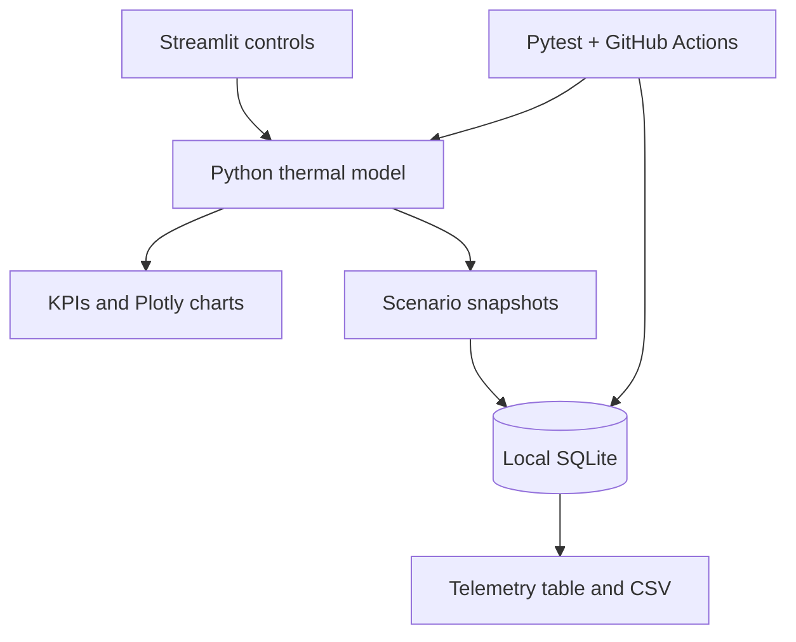

# ThermoDC 🌡️

**Data Center Thermal Monitoring & Energy Optimization Simulator**

An interactive, reproducible engineering portfolio project by **Sibly Noman**, Mechanical Engineering student at Savonia University of Applied Sciences. ThermoDC combines simplified heat-transfer modeling, Python analytics, SQL telemetry, operational scenarios, and automated testing.

[](https://github.com/siblynoman2003-beep/thermodc/actions/workflows/ci.yml)


> **Engineering integrity:** ThermoDC is an **educational steady-state digital-twin prototype**, not CFD, a calibrated thermal plant model, a real-time BMS, or safety-rated monitoring software. All rack temperatures and telemetry are synthetic. Do not use for live operational decisions.

## Features

- **Interactive dashboard:** six sliders for IT utilization, supply air, relative airflow, cooling COP, recirculation, and ambient temperature.
- **Rack-level visualization:** 12 synthetic rack inlet temperatures in a 2 × 6 heatmap.
- **Energy analytics:** IT load, cooling electricity, fan/auxiliary demand, daily energy, and PUE.
- **Scenario experiments:** normal operation, peak utilization, reduced-airflow incident, and efficient cooling.
- **Load sensitivity:** interactive curve showing maximum rack inlet temperature over utilization.
- **SQLite telemetry:** opt-in snapshot logging, queryable records, and CSV export.
- **Tests and CI:** physical trend checks, validation, and database round-trip coverage.

## Quick start

Requirements: Python 3.11 or later.

```bash
git clone https://github.com/siblynoman2003-beep/thermodc.git
cd thermodc
python -m venv .venv
# Linux/macOS:
source .venv/bin/activate
# Windows PowerShell: .venv\Scripts\Activate.ps1
python -m pip install -r requirements.txt
streamlit run app.py
```

Open the local URL printed by Streamlit (normally http://localhost:8501).

### Tests

```bash
python -m pip install -r requirements-dev.txt
python -m pytest -q
```

### Generate demo telemetry

```bash
python -m scripts.generate_demo --output data/demo.sqlite
```

## Architecture



## Modeling assumptions

| Term | Equation / assumption |
|---|---|
| Installed IT electrical capacity | 120 kW |
| IT heat load | `120 × utilization fraction` kW; all becomes heat |
| Airflow | `12 × relative airflow fraction` m³/s |
| Air properties | Density 1.2 kg/m³; specific heat 1005 J/(kg·K) |
| Air temperature rise | `ΔT = Q_IT / (ρ × V̇ × cp)` |
| Average mixed inlet | `T_supply + ΔT × recirculation fraction` |
| Rack inlet spread | Fixed synthetic position factors (not CFD) |
| Cooling electrical power | `P_cool = Q_IT / COP` |
| Fan and auxiliary power | `3 + 4 × (relative airflow fraction)^3` kW |
| Facility power | IT + cooling + auxiliary |
| Power Usage Effectiveness | Facility / IT |
| Daily energy | Facility kW × 24 h; assumes constant conditions |
| Warning marker | 27°C illustrative rack-inlet reference |
| Outdoor temperature | Display and telemetry only; COP stays user-controlled |

A **constant COP** and fixed design airflow are deliberate simplifying assumptions. No heat exchanger model, chiller capacity constraint, heat storage, humidity, pressure loss, fan curve, battery/UPS loss, hardware derating, or cooling control logic is modeled. The reduced-airflow scenario is a **steady-state what-if**; its outputs must not be interpreted as time-to-failure estimates.

## Run experiments

1. **Peak demand:** choose *Peak IT load* and examine the thermal and facility-power increase.
2. **Airflow degradation:** choose *Airflow failure* and compare synthetic inlet temperatures against normal operation.
3. **Efficiency tradeoff:** choose *Efficient cooling* and gradually adjust supply temperature and airflow; track PUE and rack temperatures.
4. **Data collection:** save snapshots and inspect the persisted SQLite records in the dashboard.

## SQL analytics examples

```sql
-- Compare scenario performance
SELECT scenario,
       ROUND(AVG(pue), 3) AS mean_pue,
       ROUND(MAX(max_inlet_c), 2) AS hottest_inlet_c,
       ROUND(AVG(facility_kw), 2) AS mean_facility_kw,
       COUNT(*) AS observations
FROM telemetry
GROUP BY scenario
ORDER BY mean_pue;

-- Find synthetic over-temperature events
SELECT timestamp_utc, scenario, max_inlet_c, hot_racks
FROM telemetry
WHERE max_inlet_c > 27
ORDER BY timestamp_utc DESC;
```

## Repository layout

```text
app.py                    Streamlit + Plotly dashboard
thermodc/model.py        Validated deterministic heat/energy model
thermodc/scenarios.py    Four preset operating scenarios
thermodc/telemetry.py    SQLite schema and persistence
scripts/generate_demo.py Reproducible synthetic data
tests/                   Unit and integration tests
.github/workflows/ci.yml Python 3.11/3.12 CI
```

## Roadmap

- [ ] Calibrate parameters against a documented benchmark or measured data.
- [ ] Add time-dependent thermal capacitance and control-loop response.
- [ ] Model variable cooling COP against weather and part load.
- [ ] Add configurable rack layout and airflow network.
- [ ] Package a Linux service and operational observability pipeline.
- [ ] Deploy a public read-only dashboard demo.

**Author:** Sibly Noman · Savonia University of Applied Sciences, Finland  
**Keywords:** Mechanical Engineering · Data Center Operations · Thermal Modeling · Python · SQL · Streamlit · Plotly · Linux · Energy Efficiency
